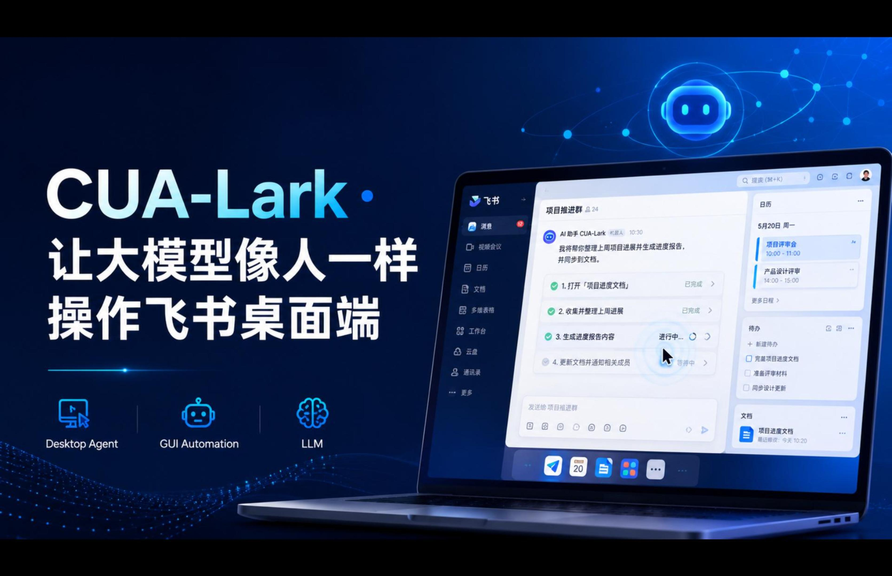
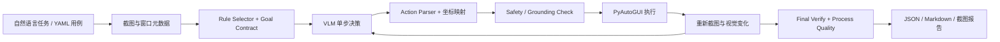

# CUA-Lark



CUA-Lark 是一个面向 macOS 飞书/Lark 桌面端的 screenshot-first 多模态 Computer-Use Agent 系统与工程框架。它以屏幕截图作为主要观测，让视觉语言模型（VLM）理解自然语言任务、选择下一步 GUI 动作、执行并重新观察；同时提供视觉定位、安全边界、完成验证、轨迹审计和实验评估能力。

当前正式版本为 **v1.0.0**。仓库内的快速单元测试共 **179 项，全部通过**。

> 项目定位：视觉感知与决策以截图/VLM 为核心；执行边界仍使用确定性的动作白名单、安全检查和报告逻辑。仓库不使用 DOM 或 Accessibility Tree 替代视觉决策。

## 核心能力

- **Screenshot-first 闭环**：截图 → 场景理解 → 单步决策 → GUI 执行 → 新截图 → 完成判断。
- **统一动作协议**：支持点击、双击、右键、拖拽、滚动、输入、快捷键、等待、批处理和结束动作；视觉坐标统一使用 0–1000 归一化空间。
- **Rule Pool + Goal Contract**：根据当前任务和截图动态选择操作规则，并在执行前定义目标、完成证据、非完成证据与禁止事项。
- **可解释视觉定位**：每个视觉动作携带 `target / bbox / point / confidence / evidence`，并保存定位裁剪图和多元素覆盖图。
- **可靠性保护**：高风险坐标二次检查、动作策略、Docs 宿主边界检查、重复动作抑制和过程质量诊断。
- **多产品用例**：包含 IM、Docs 与 Calendar 示例；核心回归测试主要覆盖 IM 和 Docs。
- **双入口**：提供 CLI 和 Gradio Web 控制台。
- **完整可观测性**：每轮输出 JSON、Markdown、逐步截图、模型输入输出、规则选择理由、耗时和视觉变化摘要。
- **模型接口兼容**：支持 OpenAI-compatible Chat Completions，也支持 Responses API 风格调用。

## 架构



详细设计见 [架构说明](docs/ARCHITECTURE.md)，评估口径见 [评估报告](docs/EVALUATION.md)。

## 环境要求

- macOS 13 或更新版本
- Python 3.10+
- 已安装并登录飞书或 Lark 桌面客户端
- 支持图片输入的 OpenAI-compatible VLM
- macOS“辅助功能”和“屏幕录制”权限

该项目会真实控制鼠标和键盘。首次使用请在测试账号和可恢复环境中运行，并先执行 dry run。

## 快速开始

```bash
git clone https://github.com/yanjiashuo/CUA-Lark.git
cd CUA-Lark

python3 -m venv .venv
source .venv/bin/activate
python -m pip install -U pip
python -m pip install -e '.[web,dev]'

cp .env.example .env
cp configs/config.example.yaml configs/config.yaml
```

在 `.env` 中填入密钥，或通过 shell 环境变量提供。不要把密钥直接写入可提交文件。

### 先运行离线检查

```bash
pytest -q
python -m compileall -q cua_lark scripts
python scripts/run_test.py --help
```

不调用模型、不操作桌面的 dry run：

```bash
python scripts/run_test.py \
  --round dry-run \
  --case IM-P2-001 \
  --static-screen assets/cua-lark-im-upload-test.png \
  --dry-run-response "Action: finished(content='dry run')"
```

### 运行真实用例

```bash
python scripts/run_test.py \
  --round im-basic-send \
  --cases tests/test_cases/phase2-im.yaml \
  --stage im_basic_send \
  --max-steps 12 \
  --rule-selection-mode vlm \
  --grounding-check \
  --final-verify
```

运行 Docs 用例时，框架会优先捕获浏览器中的飞书文档窗口：

```bash
python scripts/run_test.py \
  --round docs-demo \
  --cases tests/test_cases/docs-demo-e2e.yaml \
  --prefer-browser-docs \
  --rule-selection-mode vlm \
  --grounding-check \
  --final-verify
```

### 启动 Web 控制台

```bash
python -m cua_lark.web
# 或安装后运行：cua-lark-web
```

默认只监听 `127.0.0.1:7860`，不会自动创建公网分享地址。

## 配置模型

`configs/config.example.yaml` 默认使用环境变量读取凭据。一个后端可以选择两种 wire API：

```yaml
vlm:
  default_backend: "seed-2.0"
  seed_2_0:
    api_key: ""          # 推荐留空
    base_url: "https://ark.cn-beijing.volces.com/api/v3"
    model: "your-vision-model"
    wire_api: "chat"     # chat 或 responses
```

选择 `responses` 时，适配器会调用 OpenAI SDK 的 Responses API；选择 `chat` 时调用 Chat Completions。不同供应商对参数的支持可能不同，请按其官方文档调整 `temperature`、`max_tokens` 或 `max_output_tokens`。

## 项目结构

```text
CUA-Lark/
├── cua_lark/
│   ├── adapters/       # 截图、GUI、VLM 适配器
│   ├── domain/         # Action、Case、坐标和解析模型
│   ├── reporting/      # JSON/Markdown/截图报告
│   ├── rules/          # 可动态选择的操作规则模块
│   ├── runtime/        # 配置与路径
│   ├── scenarios/      # 通用、IM、Docs 场景协议
│   ├── testing/        # 主循环、验证和质量检查
│   └── web/            # Gradio 控制台
├── tests/
│   ├── test_cases/     # YAML 端到端用例
│   └── test_*.py       # 不操作真实 GUI 的快速测试
├── assets/             # 可公开的测试素材
├── ablation/           # 关键优化的消融记录
├── docs/               # 架构、评估、安全与发布文档
├── scripts/
└── configs/
```

## 结果与可观测性

每次运行都会创建独立目录：

```text
results/<round>-<timestamp>/
├── README.md
├── summary.json
└── cases/<case-id>__<case-name>/
    ├── record.json
    ├── steps.md
    ├── flow.md
    ├── NN-before.png
    ├── NN-after.png
    ├── NN-grounding.png
    └── final.png
```

`record.json` 适合程序分析，`steps.md` 适合人工复核。报告会保留执行 prompt、原始模型响应、规则选择、视觉变化、Grounding Check 和各阶段耗时。

## 已验证结果与口径

- 正式源码快速测试：`179/179 passed`。
- 历史 M1 基础动作验收：`7/7`。
- 历史 IM 端到端验收：基础 `5/5`、进阶 `5/5`。
- 保留的新框架运行记录中，共有 `77` 个非 setup 唯一功能用例，其中 `75` 个至少在一次真实运行中达到过 `passed`。
- Docs 最终演示链路：`7/7`。

这些数字属于不同阶段和不同统计口径，不能合并为单一“最终成功率”。“曾经通过”也不等于当前环境下一次性全量回归稳定通过；详情见 [评估报告](docs/EVALUATION.md)。

## 安全说明

- `.env`、`configs/config.yaml`、`results/`、`outputs/`、视频和压缩归档均被 Git 忽略。
- 框架保留 PyAutoGUI failsafe；将鼠标快速移至屏幕角落可触发中止。
- Web 服务默认只监听本机地址，`share=False`。
- 发布前运行 `python scripts/security_scan.py --git-history`。
- 如果密钥曾被写入文件、日志或压缩包，即使文件已删除，也必须在供应商后台轮换。

漏洞报告和凭据处理流程见 [SECURITY.md](SECURITY.md)。

## 贡献

请先阅读 [CONTRIBUTING.md](CONTRIBUTING.md)。新增用例时，应把用户指令、预期结果和验证断言分离；不要把隐藏验证条件注入执行 prompt。

## License

[MIT](LICENSE)
